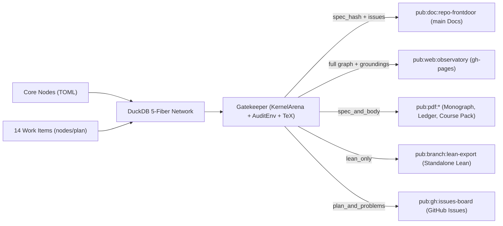

# Glass-Box Engineering & Verification Methodology (`PROCESS.md`)

This document explains the machine-checked **single-network architecture** powering *Categorical Reverse Mathematics — Volume II: Universes, Classes, and Higher Fixed Points*.

## 1. Single-Network 5-Fiber DAG & DuckDB SQL Gates

All mathematical definitions, theorems, counterexamples, inline claims, prose blocks, summary tables, symbol registries, Volume I contracts, roadmap work items (`nodes/plan/*.toml`), and publication sinks (`nodes/pub/*.toml`) live as declarative TOML nodes compiled deterministically by `scripts/compile_db.py` into `build/vol2.duckdb` (`scripts/schema.sql`).

Edges span **five orthogonal fibers** (currently `504` total directed edges):

1. **`logical_dep` (123 edges):** Mathematical and structural proof dependencies.
2. **`lean_dep` (44 edges):** Formal Lean 4 module/declaration dependencies verified by the Hidden-Edge Gate.
3. **`prose_paraphrase` (94 edges):** Spec-hash-locked paraphrasing links from formal/claim nodes into Cohort IV prose containers and `pub:doc:repo-frontdoor`.
4. **`notation` (134 edges):** Automatic dependencies induced by `{{sym:...}}` and `{{ref:...}}` macros.
5. **`curriculum` (109 edges):** Pedagogical dependencies used by `scripts/slice_course.py` to carve standalone Royal Octavo Course Packs.

DuckDB enforces four structural SQL invariants on every compile:
- **Per-Fiber & Structural-Union Acyclicity:** Terminating `WITH RECURSIVE` CTE cycle checks across each fiber individually and across their union.
- **Pinned Volume I Boundary:** Every `vol1_external` contract has in-degree `0`.
- **Two-Package TCB Isolation:** Zero `lean_dep` edges may cross between `mathlib_vol2` and `kernel_arena`.
- **Publication Sink Discipline:** Every `pub_target` has out-degree `0` across all five fibers.

## 2. Two-Hash Taint Isolation (`spec_hash`, `body_hash`, `grounding_hash`) & `harvest_body.py`

Each node splits its content into three cryptographically isolated digests:

| Hash Domain | Prefix | Covered Fields | Effect of Mutation |
|---|---|---|---|
| `spec_hash` | `VOL2_SPEC_V1\0` | `id`, `kind`, `axis`, `grounding_tier`, `formal_pkg`, `[spec]` (Lean signatures, statements, or 2LTT goal AST + strata flags) | Direct `TAINTED` on node + transitive `TAINTED` across all downstream fibers + `PROSE_LOCK_MISMATCH` on locked consumers |
| `body_hash` | `VOL2_BODY_V1\0` | `[body]` (`lean_body`, LaTeX proof/exposition `tex`), plus 2LTT `proof_term_ast`, `fuel_hint`, `sha256_arena` | `BODY_DIRTY` on the edited node **only** (`0` downstream propagation) |
| `grounding_hash` | `VOL2_GROUNDING_V1\0` | `[grounding]` (`primary_category`, `blueprint_tier`, `characterization_types`, `witness_scope`, `dual_pillars`) | `GROUNDING_DIRTY` on the edited node **only** (re-checked by all 5 Honesty Invariants) |

When iterating on Lean tactics inside emitted `mathlib_vol2/HomotopyCRM/Vol2/*.lean` files, `scripts/harvest_body.py` harvests ONLY the region between `-- BEGIN_BODY <id>` and `-- END_BODY <id>` back into the source TOML, hard-rejecting (`E_SIGNATURE_MUTATION`) any edit outside body markers.

## 3. `prose_paraphrase` Anti-Drift Locks

Every Cohort IV prose container (`prose_block`, `summary_table`) and `pub:doc:repo-frontdoor` attaches explicit `[[edges.prose_paraphrase]]` locks pinning `locked_spec_hash` to the exact `spec_hash` of each referenced theorem or definition. Whenever an underlying mathematical statement changes, `compile_db.py` immediately raises `PROSE_LOCK_MISMATCH`, taints the prose consumer, and hard-blocks `gatekeeper.py --publish` until the prose summary is reviewed and re-locked.

## 4. Two-Package Trusted Computing Base (`mathlib_vol2` + `kernel_arena`)

- **`kernel_arena/` (Zero-`Mathlib` 2LTT Kernel):** A standalone Lean 4 package (`leanprover/lean4:v4.28.0`) implementing a two-level type theory checker separating fibrant types (`U^f`) from strict types (`U^s`) with only the one-way lift `U^f -> U^s`. Every certificate JSON (`certs/*.2ltt.json`) carries a canonical SHA-256 arena digest verified both by `lake exe kernel-arena verify` and kernel-reduced (`rfl`, zero axioms) inside `HomotopyCRM.Vol2.CertChecks`.
- **`mathlib_vol2/` (`HomotopyCRMVol2` + `AuditEnv.lean`):** Standard Lean 4 + `mathlib4` formalization package. After `lake build HomotopyCRM audit_env`, `AuditEnv.lean` reflects over the compiled `Environment`, verifies every node's declared `decl_names` (rejecting `.axiomInfo`, `.opaqueInfo`, `sorryAx`, `Lean.ofReduceBool`, `Lean.trustCompiler`, or unregistered custom axioms), and enforces the **Hidden-Edge Gate**: every `HomotopyCRM.Vol2.*` constant referenced directly or transitively must belong to a declared ancestor in that node's backward `lean_dep` cone.

## 5. Four-Color Stratum Spectrometer

`AuditEnv.lean` computes each formal node's constructive stratum directly from `Lean.CollectAxioms.collect` and enforces an exact match with its TOML `stratum`:

| Stratum | Kernel Axioms | Semantics |
|---|---|---|
| **Emerald** | `[]` | Purely constructive, axiom-free Lean 4 or zero-axiom `KernelArena` kernel reduction |
| **Sapphire** | Safe 2LTT | Two-level type-theoretic extension (`innerUnivalenceV`, `innerCoalgebraNu`, `outerStrictEq`, `smallnessReplacement`) inside `KernelArena` |
| **Amber** | `propext`, `Quot.sound` | Propositional extensionality and/or quotient soundness without choice |
| **Crimson** | `Classical.choice` (+ `propext`, `Quot.sound`) | Classical choice-dependent theorems |

## 6. Two-Tier Honesty (`\leanok` / `\leanwitness`) & Five Honesty Invariants

LaTeX rendering (`scripts/emit_tex.py`) distinguishes complete formalizations (`\leanok` / `\twolttok`) from scoped computational witnesses (`\leanwitness` / `\twolttwitness` with a mandatory `witness_scope` explaining which part is mechanized vs. proved in the monograph). `compile_db.py` enforces five hard honesty invariants across Cohorts I–IV:

1. **1-to-1 Declaration Ownership (`decl_ownership`):** Every Lean declaration and 2LTT certificate path is owned by at most one node.
2. **Two-Tier Blueprint Honesty:** `lean_ok` / `twoltt_ok` cannot be claimed on partial witnesses; `lean_witness` / `twoltt_witness` requires a non-empty `witness_scope`; `Proved by Lean code` / `Proved by 2LTT certificate` requires full `*_ok` status.
3. **Citation-Locator Non-Vacuity:** Every `external_theorem`, `folklore`, or `standard_def` node must cite a verified BibTeX key from Volume I/II `.bib` files with an explicit theorem/section/page locator.
4. **Conjecture Quarantine:** No unflagged proved node may depend transitively along `logical_dep` on an `unfounded_conjecture` or `open_problem` without `spec.conditional_on_conjecture = true`.
5. **Cohort IV Paraphrase Completeness:** Every `prose_block` and `summary_table` must carry at least one incoming `prose_paraphrase` edge.

## 7. Pass A / B / C Taint Drill Verification & Publication Impact Graph

During Phase 0 (`logs/drill_report.json`), the three-pass adversarial drill verified the taint and isolation guarantees end-to-end:

- **Pass A (Clean Baseline):** `10/10 CLEAN`, `0 TAINTED`, `0` cycles, `0` TCB violations, `6` audited formal nodes, `3/3` Royal Octavo PDFs clean.
- **Pass B (Clause 3 Spec Injection):** Injecting Clause 3 into `ch01:def:probe-suite` changed its `spec_hash`, producing `7 TAINTED` nodes, mapping the missing-field Lean error (`ProbeSuite.lean:274`) directly back to `ch01:cex:flow-f1-frontier-nonmonotone` via sourcemaps, and flagging `PROSE_LOCK_MISMATCH` on both Cohort IV nodes.
- **Pass C (Remediation + Body Isolation):** Remediating Clause 3 restored `10/10 CLEAN`; `harvest_body.py` accepted `-- BEGIN_BODY` edits and rejected out-of-bounds signature edits; mutating `lean_body` produced `BODY_DIRTY=1 / TAINTED=0 / CLEAN=9`, proving statement-vs-proof hash isolation.

For publication, each out-degree-0 `pub_target` (`nodes/pub/*.toml`) computes a deterministic `cone_hash` in DuckDB scoped to its `sensitivity` (`spec_and_metrics`, `spec_and_body`, `spec_body_and_grounding`, `lean_only`, or `plan_and_problems`) and compares it against `manifest/publication_lock.json` (`CLEAN`, `ARTIFACT_DIRTY`, or `TAINTED` — which hard-blocks `gatekeeper.py --publish`):

## 8. Cross-Volume Precision Guardrails & Portable Fence

The Volume I repository (`../categorical-reverse-mathematics`, pinned HEAD `b849be75`) is **strictly read-only**, verified before and after local builds by `scripts/fence_check.py --verify` (and logged as `SKIPPED_REMOTE_CI` on GitHub Actions where the sibling Volume I clone is absent). Every Volume II slice enforces the five Volume I guardrails (`manifest/guardrails.toml`):

1. **`nom_not_iac` — Schanuel Nominal Topos Refutes Internal Choice** (Volume I anchor `rem:anchor-witnesses`): In Schanuel's nominal topos Nom = Cont(Sym(N)), LEM holds while IAC, AC_omega, and Proj_1 all fail: Nom |= LEM and Nom |/= IAC.
2. **`ordinal_rank_base` — Ordinal-Rank Zero Base Clause** (Volume I anchor `HomotopyCRM.OrdinalRankCompleteness`): The base clause of ordinal rank completeness is rank(D) = 0 iff D is equivalent to its maximal subgroupoid D^simeq.
3. **`ltt_eff_muchnik_meets` — Muchnik Meets in the Effective Topos Sublattice** (Volume I anchor `def:doctrinal-philosophy`): In the Lawvere-Tierney topology lattice LTT(Eff), non-trivial Muchnik meets strictly dominate the identity topology: j_{O_1} /\ j_{O_2} > id_Omega.
4. **`global_section_dc` — Global-Section Dependent Choice via Epic First Projection** (Volume I anchor `ch:choice-atlas`): Global-section Dependent Choice (DC) is formulated via epic first projection pr_1 : R ->> X.
5. **`cumulative_hierarchy_strict_inclusion` — Strict Inclusion Below V_{omega+omega}** (Volume I anchor `ch:sets-residuum`): The finite-iterated powerset of N is strictly contained in V_{omega+omega} = union_n P^n(V_omega), separating Zermelo boundedness from full replacement.
