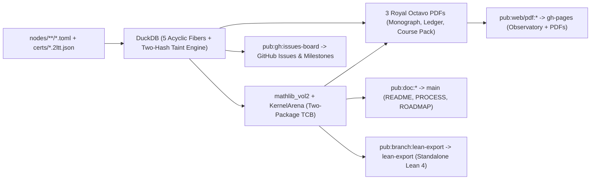

# Categorical Reverse Mathematics — Volume II
### *Universes, Classes, and Higher Fixed Points*

> **[Live Interactive Glass-Box Observatory (GitHub Pages)](https://tryggth.github.io/categorical-reverse-mathematics-vol2/)** · **[How This Book Is Built (`PROCESS.md`)](PROCESS.md)** · **[14-Slice Project Plan (`ROADMAP.md`)](ROADMAP.md)**  
> **Live Royal Octavo PDFs:** [Monograph PDF](https://tryggth.github.io/categorical-reverse-mathematics-vol2/pdfs/crm_vol2_monograph.pdf) · [4-Part Master Claims Ledger PDF](https://tryggth.github.io/categorical-reverse-mathematics-vol2/pdfs/crm_vol2_claims_ledger.pdf) · [Ch. 1 Course Pack PDF](https://tryggth.github.io/categorical-reverse-mathematics-vol2/pdfs/course_pack_ch01_probe_calibration.pdf)  
> **Synced Engineering & Open-Problem Backlog:** [GitHub Issues](https://github.com/tryggth/categorical-reverse-mathematics-vol2/issues) · [Milestones](https://github.com/tryggth/categorical-reverse-mathematics-vol2/milestones)

> **Glass-Box 5-Fiber Formalization & Monograph Network (`Phase 1B`)**  
> **Author:** James F. Walters (Port Townsend, Washington) · **License:** CC BY 4.0 · **Working Title Locked:** `false`  
> **Companion to Volume I:** `../categorical-reverse-mathematics (HEAD b849be75)` · Zenodo Concept DOI [`10.5281/zenodo.24238086`](https://doi.org/10.5281/zenodo.24238086)

Volume II is developed as a **single-network, machine-checked mathematical and monograph architecture**. Every mathematical definition, theorem, counterexample, 2LTT certificate, LaTeX section, roadmap slice, and publication sink compiles into `build/vol2.duckdb` across five orthogonal fibers (`logical_dep`, `lean_dep`, `prose_paraphrase`, `notation`, `curriculum`) with zero cycles, disjoint 1-to-1 declaration ownership, and strict separation between **formal statement integrity (`spec_hash`)** and **proof/exposition edits (`body_hash`, `grounding_hash`)**.

## Book-Creation Architecture



> **Branch Guide (Do Not Merge `lean-export` / `gh-pages` into `main`):**
> - **`main`** — Canonical single-network source of truth (`nodes/**/*.toml`, `certs/*.2ltt.json`, `scripts/`, `manifest/`, `README.md`, `PROCESS.md`, `ROADMAP.md`). All mathematical edits and PRs target `main` only.
> - **`lean-export`** — Standalone auto-generated Lean 4 + `KernelArena` projection branch (`scripts/export_lean_branch.py`, committed via `GIT_INDEX_FILE` without DuckDB or LaTeX). **Do not merge `lean-export` into `main`.**
> - **`gh-pages`** — Auto-generated static Glass-Box Observatory + 3 Royal Octavo PDFs (`scripts/emit_observatory.py`, committed via `GIT_INDEX_FILE`). **Do not merge `gh-pages` into `main`.**

## Live Public Surfaces

| Surface | Channel | Location |
|---|---|---|
| **Source Repository (`main`)** | GitHub | [tryggth/categorical-reverse-mathematics-vol2](https://github.com/tryggth/categorical-reverse-mathematics-vol2) |
| **Glass-Box Interactive Observatory** | `gh-pages` | [https://tryggth.github.io/categorical-reverse-mathematics-vol2/](https://tryggth.github.io/categorical-reverse-mathematics-vol2/) |
| **Standalone Lean 4 + KernelArena Workspace** | `lean-export` | [branch `lean-export`](https://github.com/tryggth/categorical-reverse-mathematics-vol2/tree/lean-export) |
| **Royal Octavo Monograph PDF** | Observatory PDF | [crm_vol2_monograph.pdf](https://tryggth.github.io/categorical-reverse-mathematics-vol2/pdfs/crm_vol2_monograph.pdf) |
| **4-Part Master Claims & Grounding Ledger PDF** | Observatory PDF | [crm_vol2_claims_ledger.pdf](https://tryggth.github.io/categorical-reverse-mathematics-vol2/pdfs/crm_vol2_claims_ledger.pdf) |
| **Standalone Ch. 1 Course Pack PDF** | Observatory PDF | [course_pack_ch01_probe_calibration.pdf](https://tryggth.github.io/categorical-reverse-mathematics-vol2/pdfs/course_pack_ch01_probe_calibration.pdf) |
| **Glass-Box Methodology & Taint Engine Guide** | Repository Doc | [PROCESS.md](PROCESS.md) |
| **14-Slice Volume II Project Plan** | Repository Doc | [ROADMAP.md](ROADMAP.md) |

## Current Verification Telemetry

- **Core Mathematical, Prose, & Symbol Nodes:** `33` (`33` CLEAN, `0` TAINTED across `274` directed edges)
- **14-Slice Blueprint (`nodes/plan/*.toml`):** `3 VERIFIED`, `1 ACTIVE`, `10 PLANNED` — active slice: `plan:ch02-class-set-adjunction` (Ch. 2 (Part I): Class-Set Adjunction, Mod(GB_0), & Williams Kaleidoscope)
- **Publication Sinks (`nodes/pub/*.toml`):** `7` out-degree-0 sinks (`main_docs`, `gh_pages`, `lean_export`, `gh_issues`)
- **Two-Package TCB (`leanprover/lean4:v4.28.0`):** `235` disjoint Lean 4 declarations (`HomotopyCRMVol2` + `AuditEnv`) + `1` zero-`Mathlib` `KernelArena` 2LTT certificates (`0` cross-package `lean_dep` edges)
- **Four-Color Stratum Spectrometer:** Emerald=21, Sapphire=0, Amber=1, Crimson=2, Prose/Symbol=9
- **Four-Part Grounding Cohorts:** Cohort I=15, Cohort II=13, Cohort III=2, Cohort IV=3

## Headline Verified Nodes (Locked via `prose_paraphrase`)

| Node ID | Title | Stratum | Blueprint Tier | Spec8 |
|---|---|---|---|---|
| `ch01:thm:mode3-orbit-stabilizer-exactness` | Mode (iii) Orbit-Stabilizer Exactness and (R_{2,2}, phi_aug) Decomposition | Amber (`propext` / `Quot.sound`) | `lean_ok` | `8dbdf070` |
| `ch01:rem:trident-mode3-2ltt-bootstrap` | Mode (iii) Obstruction Trident Preview: Zero-Mathlib 2LTT Bootstrap | Emerald (Axiom-Free) | `twoltt_ok` | `789da10e` |
| `ch01:def:probe-suite` | Doctrinal Problem and Calibrated Probe Suite (Clauses 1–3) | Emerald (Axiom-Free) | `lean_witness` | `069b4c14` |
| `ch01:thm:scotoma-pareto-trichotomy` | Epistemic Trichotomy: Scotoma, Unique Residuum, or Pareto Schism | Crimson (`Classical.choice`) | `lean_ok` | `73d0580b` |
| `ch01:thm:flow-f1-threshold-order` | Flow F1 Threshold Ordering (t_wake <= t_dogma) | Emerald (Axiom-Free) | `lean_ok` | `d8f9b2fd` |
| `ch01:cex:flow-f1-frontier-nonmonotone` | Finite 5-Point Counterexample: Non-Monotone Pareto Cardinality (1 -> 2 -> 1) | Emerald (Axiom-Free) | `lean_ok` | `08bfdee1` |
| `ch01:prop:extent-transversal-galois` | 2-Chu Extent-Transversal Galois Duality and Maximal-vs.-Minimal Reconciliation | Emerald (Axiom-Free) | `lean_ok` | `8e07cdaa` |
| `ch01:thm:flow-f2-four-rung-escalation` | Flow F2 Strict Four-Rung Stability Escalation and Etale Slice Collapse | Emerald (Axiom-Free) | `lean_witness` | `ad78ce8e` |
| `ch01:prop:flow-f3-lt-partition-and-schism` | Flow F3 Reflective Localization Partition (3^k 2^m) and Realizability Pareto Schism | Emerald (Axiom-Free) | `lean_witness` | `20719a85` |
| `ch01:thm:flow-f4-split-polarity-transport` | Flow F4 Split-Polarity Transport Law Along Mixed-Variance Conversions | Emerald (Axiom-Free) | `lean_ok` | `8127e3cb` |
| `ch01:prop:topological-no-schism` | Topological No-Schism Principle Under Binary Union Closure | Emerald (Axiom-Free) | `lean_ok` | `05485242` |
| `ch01:thm:zero-giraud-representation` | Constructive 0-Giraud Representation Theorem and Banishment of Dogma and Immortal Casuistry | Emerald (Axiom-Free) | `lean_ok` | `af254dbf` |
| `ch01:thm:zero-giraud-living-zone-zorn` | 0-Giraud Living-Zone Existence Theorem via Zorn's Lemma | Crimson (`Classical.choice`) | `lean_ok` | `8bfdda6e` |
| `ch01:cex:p0-independent-of-p1-p5` | Independence of Core-Target Aperture (P0) from 0-Giraud Axioms (P1)-(P5) | Emerald (Axiom-Free) | `lean_ok` | `50684198` |
| `ch01:def:operational-currencies` | The Four CRM Operational Currency Regimes | Emerald (Axiom-Free) | `lean_ok` | `a127c150` |
| `ch01:thm:morita-resource-interleaving` | Quasi-Isometric Morita Resource Interleaving Theorem | Emerald (Axiom-Free) | `lean_witness` | `b120a3e9` |
| `ch01:cex:russells-socks-levelwise-morita-failure` | Russell's Socks Touchstone: Failure of Levelwise Morita Invariance at k = 1 | Emerald (Axiom-Free) | `lean_ok` | `c177cab6` |

## Quickstart & Local Verification

```bash
# 1. Compile the 5-fiber DuckDB network and run structural/honesty gates
python3 scripts/compile_db.py

# 2. Verify generated front-door documentation freshness
python3 scripts/emit_public_docs.py --check

# 3. Emit Lean 4 sources and run zero-Mathlib 2LTT KernelArena self-tests + cert checks
python3 scripts/emit_lean.py
lake --dir kernel_arena build
lake --dir kernel_arena exe kernel-arena --self-test
lake --dir kernel_arena exe kernel-arena verify certs/ch01_bool_id_bootstrap.2ltt.json

# 4. Build Mathlib Vol II modules and run AuditEnv axiom/stratum/hidden-edge checks
(cd mathlib_vol2 && lake exe cache get && lake build HomotopyCRM audit_env && lake exe audit_env ../build/audit_nodes_manifest.json)

# 5. Run the complete verification gatekeeper (including Royal Octavo PDFs locally)
python3 scripts/gatekeeper.py
```

> **Note on Standalone Lean Use:** If you only want the generated Lean 4 + `KernelArena` codebase without compiling DuckDB or LaTeX, switch to or clone the standalone [`lean-export`](https://github.com/tryggth/categorical-reverse-mathematics-vol2/tree/lean-export) branch.
